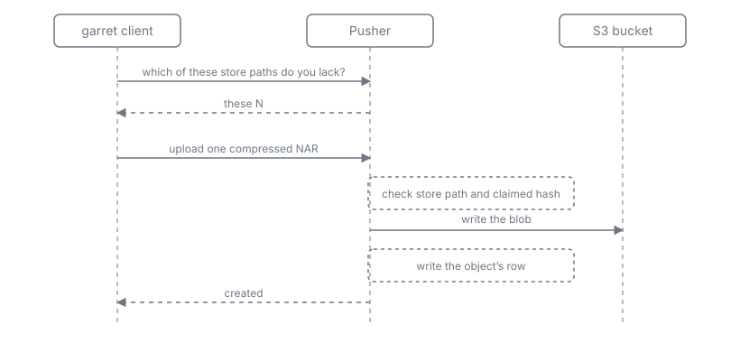
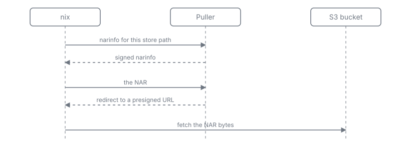

# How it works

Garret is two services over one database and one bucket. This page is the shape
of the system, not its wire formats.

## Why two services

The split is about exposure and authentication, not placement. The Pusher
decides who may write and is never public; the Puller serves reads to anyone and
holds no authority to write. Both run on one host and share one database file
and one bucket, so there is no network hop between them and no second copy of
the metadata.

## Push

The client sends the whole closure once to ask what is missing, then uploads
only what the cache lacks. Each path is one compressed NAR, streamed rather than
buffered.

The Pusher checks the store path and the claimed hash before it reads the body,
and answers "already present" immediately if another writer got there first. The
client may still be sending at that point, so a deduplicated path may still have
cost bandwidth.

The object's row is written after its blob. That ordering is the invariant: a
row never points at a missing blob. An orphaned blob with no row is possible and
expected, and a periodic sweep removes it.

Pushes are idempotent. Two clients pushing the same closure, or a client
retrying after a dropped connection, produce the same result.

## Pull

The Puller signs narinfos with the cache's ed25519 keys, so nix verifies them
like any other cache. It never proxies NAR bytes: it answers with a redirect to
a URL that grants one read for a limited time, and the client fetches the bytes
from the bucket directly. Presigned URLs are cached in-process and reused while
at least half their configured lifetime (`presignTtlSeconds`) remains, so a
repeated pull of one object does not re-sign, and no client is ever handed a URL
with less than half its lifetime left.

That keeps the Puller small and fast, and it means the bucket must be reachable
by the machines that substitute. It also means a pull that cannot reach the
bucket fails at the client, not at the Puller.

## Storage

One compressed NAR per store path, keyed by the path's hash. There is no
chunking, no content deduplication and no reference counting. Reuse happens at
path granularity: the negotiation step is what stops a client uploading
something the cache already has.

The cost of that choice is that two store paths with nearly identical contents
are stored twice. The benefit is that every object is one blob, so reads,
deletes and repairs are single operations.

## Metadata

One SQLite database in WAL mode, shared by both services. The Pusher performs
every write: objects, references, garbage collection, signatures. The Puller is
read-only except for one thing — it records last-accessed times, in a debounced
batch, because eviction orders by them.

Because the Pusher is the only writer, there is no coordination protocol between
the services: no locks, no leader election, no queue.

## Signing

The cache holds one or more ed25519 signing keys. Narinfos are signed with all
of them, so a key rotation can overlap: clients that trust either key keep
working. `garret-admin resign` backfills signatures after a key is added, and
refuses to sign a row whose existing signatures do not verify under a configured
key, so tampered metadata never gains a valid signature.

## Garbage collection

A quota with a high and a low watermark. Eviction removes the
least-recently-accessed objects first, and only objects that nothing else needs:
no surviving object references them, no pin holds them, and no push used them
within the push grace. Pins exempt a whole closure. Prune removes everything
last pushed before a cutoff, independent of the quota, with the same safety
rules.

The result is that every closure the cache still serves stays complete. A cache
can run out of evictable objects before it reaches its low watermark; when that
happens it stops and raises an alarm rather than deleting something a closure
needs.

## When something is wrong

- A pull that cannot meet its time budget answers 404 and increments a counter
  rather than hanging. A cache miss and a degraded lookup look the same to nix,
  which then builds or substitutes elsewhere.
- A database that is not ready yet answers 503, so the Puller can start before
  the Pusher has created the file.
- An upload that arrives while its object is being deleted, or while a repair is
  draining uploads, gets 503 with a retry hint. The client waits it out on its
  own deadline instead of spending retries.
