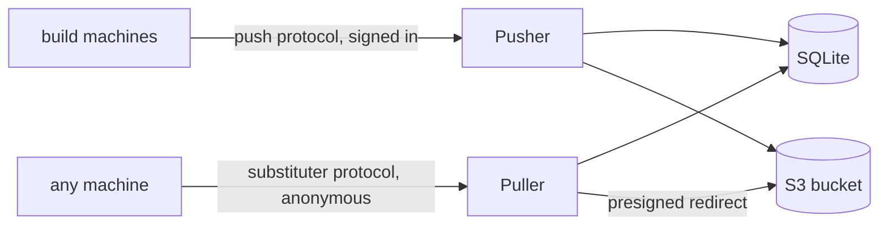

# Introduction

Garret is a single-tenant Nix binary cache. An authenticated **Pusher** accepts
store paths; a public **Puller** serves them to any machine whose `nix.conf`
points at it. Both run on one host over SQLite and an S3-compatible bucket.

## Components

| Component | What it does | Who can reach it |
|---|---|---|
| Pusher | Accepts pushes, owns the cache's metadata, runs garbage collection | Authenticated; not public |
| Puller | Serves narinfo and NARs to nix, and the browse API behind `garret list`, `tree` and `pins` | Public; browse requires sign-in and is absent when `browse_oidc` is unset |
| `garret` | The client: push, watch the local store, list, doctor | Runs on build machines and anywhere you push from |
| `garret-admin` | Key management, garbage collection, prune, pins, fsck, delete, backup | Runs on the server host |

## Topology

The two services are separate because they face different audiences: the Pusher
decides who may write, and the Puller serves reads to the world. They share one
database file and one bucket, so they run on the same host.

## Limits

- One tenant and one cache per deployment.
- Both services run on one host and share one database.
- An interrupted upload starts over; there is no resume.

Read [How it works](how-it-works.md) for the shape of a push and a pull, or go
straight to [Installation](install.md).
